<p align="center">
  
</p>

<h1 align="center">FluxPlane</h1>

<p align="center"><strong>Multimodal feature fusion for continuously updated analytics.</strong></p>

<p align="center">
  <strong>融合多模态特征，让分析跟上数据变化。</strong><br>
  将结构化数据与文档文本组织为可关联、可持续更新的分析特征，统一完成计算、查询与版本管理。
</p>

<p align="center">
  <a href="pyproject.toml"></a>
  <a href="compose.yaml"></a>
  <a href="docs/architecture.md"></a>
  <a href="#当前范围"></a>
</p>

<p align="center">
  <a href="#快速体验">快速体验</a> &nbsp;&middot;&nbsp;
  <a href="#控制台导览">控制台</a> &nbsp;&middot;&nbsp;
  <a href="#一个完整案例">完整案例</a> &nbsp;&middot;&nbsp;
  <a href="#系统架构">架构</a> &nbsp;&middot;&nbsp;
  <a href="#运行与文档">文档</a>
</p>

## 为什么是 FluxPlane

订单在数据库里，商品在文件里，退款通过 API 更新，业务规则写在文档里。一条 SQL 可以把它们连接起来，但要让报表持续可用，还需要处理来源变化、特征刷新、任务竞争，以及新旧版本之间的切换。

**FluxPlane 将结构化记录与文档文本中的特征连接到同一分析流程。** 数据接入后成为有版本的数据集，SQL 与文本算子提取所需特征，再通过关联与聚合形成分析结果。特征声明自己的依赖，后台按来源变化和时间窗口安排刷新；查询绑定已发布的版本组合，控制台展示每一步的输入、状态和产物。

我们希望，让一份分析从“这次能跑通”走向“数据变化后，仍然能追踪、更新和复现”。

<p align="center">
  <a href="architecture/fluxplane.png">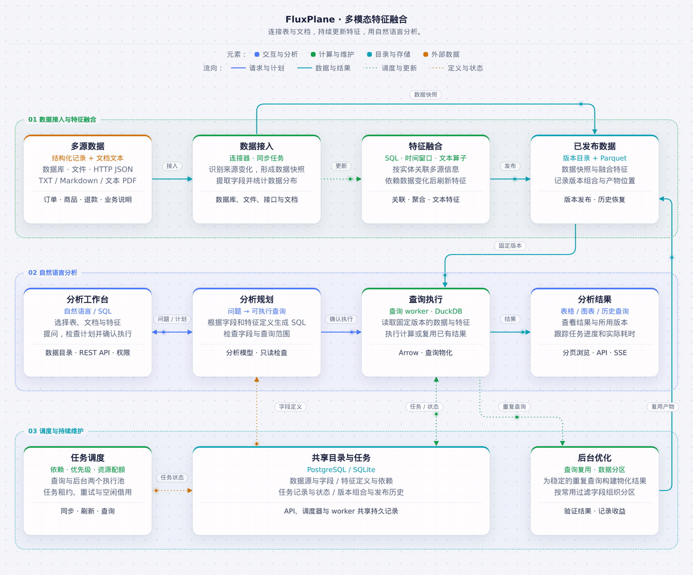</a>
</p>

<p align="center"><a href="architecture/fluxplane.png">高清图</a> &nbsp;&middot;&nbsp; <a href="architecture/fluxplane.mp4">视频</a> &nbsp;&middot;&nbsp; <a href="architecture/fluxplane.html">独立网页</a></p>

|  接入多源数据 |  融合与维护特征 |  按版本交付分析 |
| :--- | :--- | :--- |
| 将数据库、文件、HTTP 和文档纳入统一目录，查看字段、来源与快照。 | 用 SQL、事件窗口和文本算子提取特征，关联结构化与文本信息，沿依赖持续更新。 | 查询固定一个发布版本，查看历史、恢复旧版本，复用稳定的查询结果。 |

## 控制台导览

从浏览表和文档，到用自然语言描述分析目标，控制台将数据、操作计划和结果连在一起。每次执行都有对应的任务和输入版本，可以回看结果，而不必在多个页面之间寻找。

| 浏览数据 | 提问与执行 |
| :--- | :--- |
| 按来源分组，点开表查看内容、字段分布和历史版本。文档有独立阅读视图，特征可以追踪到输入数据。 | 选择表与特征，用自然语言生成只读分析计划。确认口径后执行，查看进度，并在表格与图表之间切换。 |

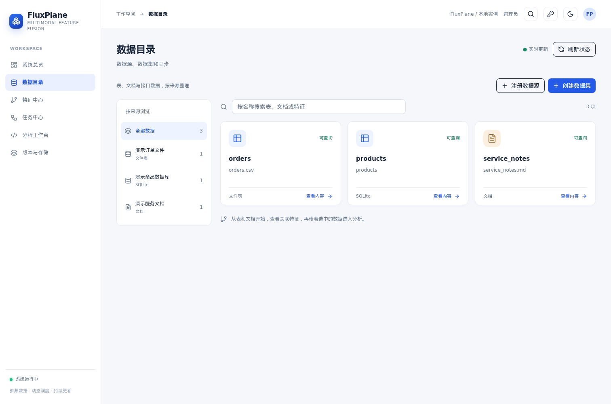

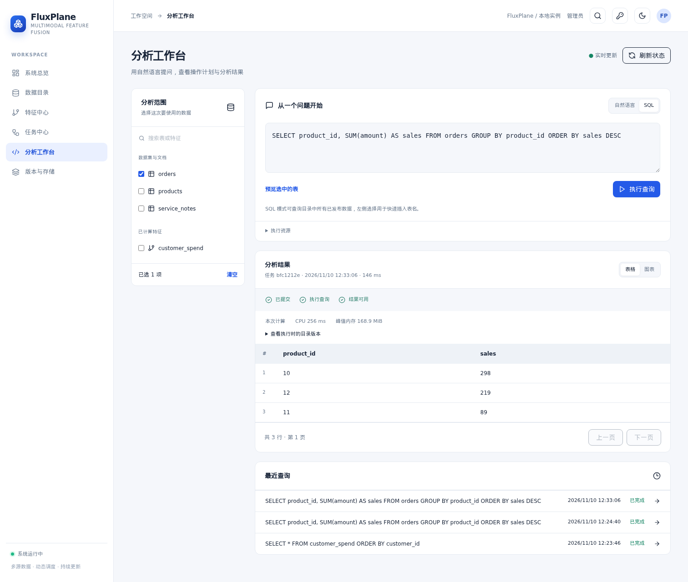

演示查询无需模型服务；连接模型后，可以用自然语言生成操作计划。[连接模型与完整体验步骤](docs/analysis-workbench.md)

<p align="center">
  <a href="docs/assets/console-workflow.png">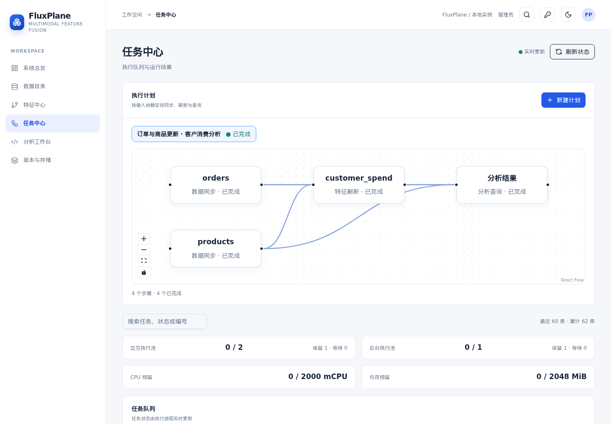</a>
</p>

<table>
  <tr>
    <td width="50%" valign="top">
      <strong> 特征与依赖</strong><br>
      从输入数据集追踪到特征，查看定义、更新状态和计算关系。<br><br>
      <a href="docs/assets/console-features.png">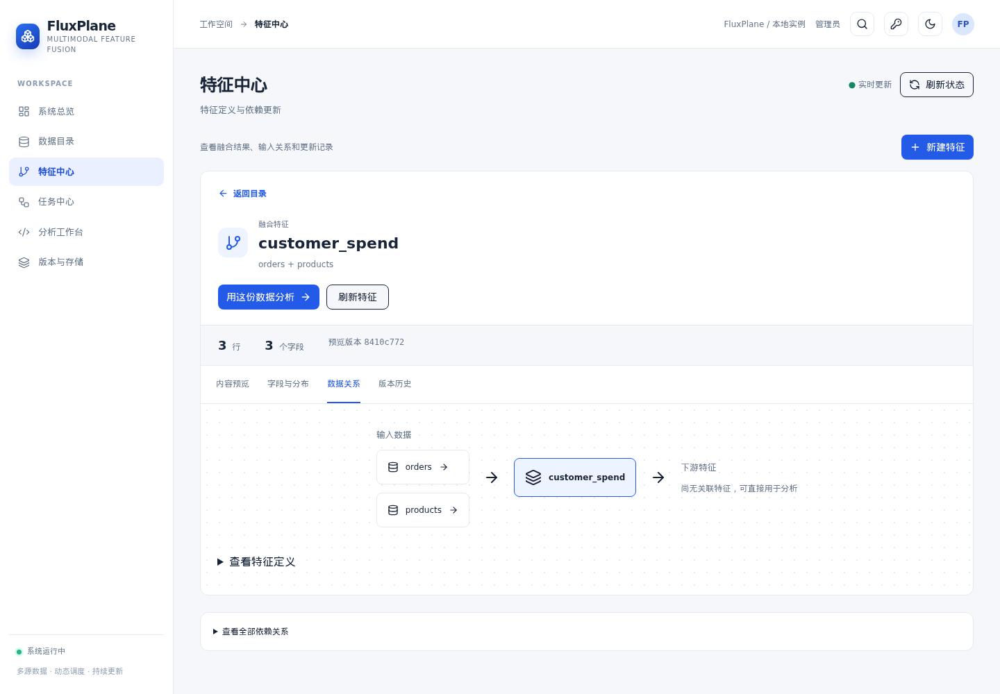</a>
    </td>
    <td width="50%" valign="top">
      <strong> 物化与复用</strong><br>
      查看重复查询的物化结果、命中次数、构建耗时与存储占用。<br><br>
      <a href="docs/assets/console-materializations.png">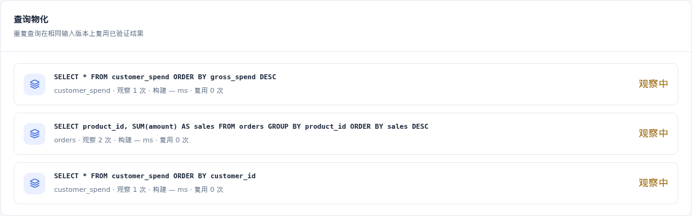</a>
    </td>
  </tr>
</table>

<details>
<summary>更多界面：系统总览、发布历史与移动端</summary>

### 系统总览

查看来源、数据集、特征与任务状态，以及执行池的实际运行观测。

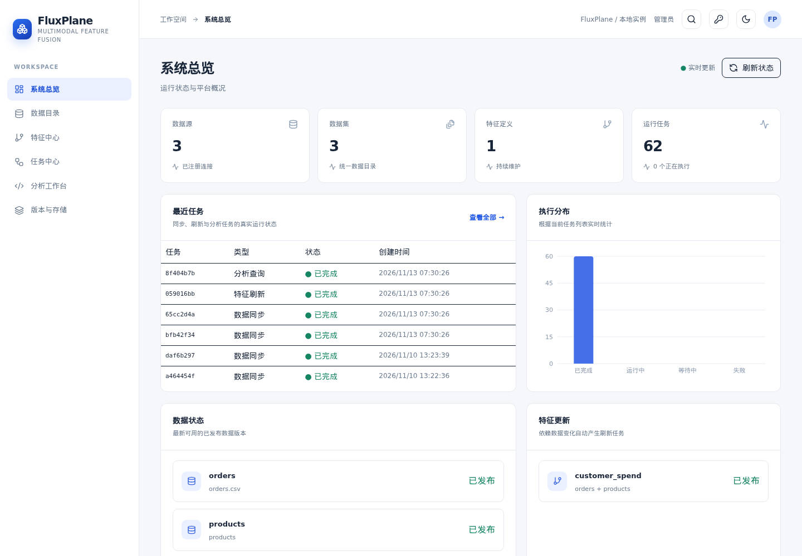

### 发布历史

查看数据与特征的版本组合、存储产物，并恢复先前的发布版本。

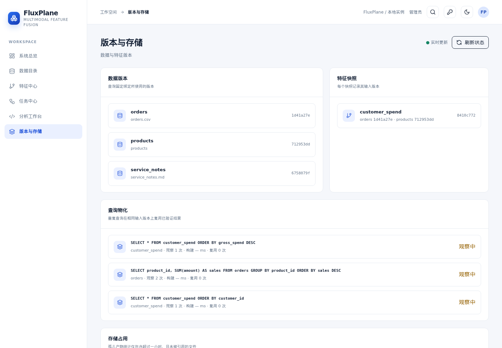

### 移动端任务中心

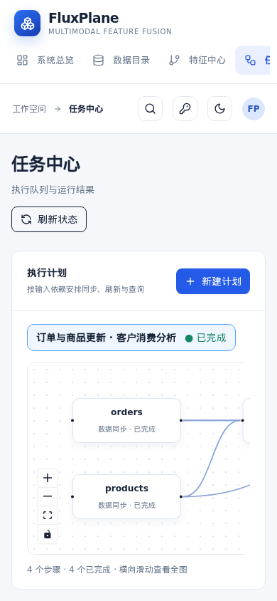

</details>

## 快速体验

需要 **Docker 与 Docker Compose v2**。复制以下命令即可启动：

```bash
git clone https://github.com/WannaBSteve/FluxPlane.git
cd FluxPlane
bash scripts/quickstart.sh
```

脚本会创建仅供本地演示的 `.env`、启动服务并装载订单、商品、退款和文档数据。打开 **<http://127.0.0.1:8088>**，进入「分析工作台」，点击「各品类销售额」或「退款后的净额」，再点击「执行查询」。也可以在「数据目录」点开表和文档，查看内容、字段与版本。**首次体验不用准备数据库、API 密钥或模型服务。**

Web 默认只监听 `127.0.0.1`。若已有 `.env`，脚本会保留原配置；已设置访问密钥的实例仍需在控制台输入密钥。接入自己的数据或对外部署时，请按[部署配置](docs/technical-reference.md#容器部署)设置访问密钥。

### 观察数据变化

```bash
# 重复执行稳定查询，观察后台物化与结果复用
docker compose exec api python examples/full_demo.py --phase optimize

# 更新订单与退款，观察特征刷新和报表变化
docker compose exec api python examples/full_demo.py --phase update
```

| 在哪里看 | 可以观察到什么 |
| :--- | :--- |
| 数据目录 | 来源状态、字段画像、数据版本 |
| 特征中心 | 输入依赖、特征定义与刷新后的快照 |
| 任务中心 | 同步、刷新、查询的执行状态和资源观测 |
| 分析工作台 | 直接运行演示查询、查看跨源结果与图表；连接模型后用自然语言提问 |
| 版本与存储 | 发布历史、查询物化、产物与恢复入口 |

完整的校验顺序见[案例指南](docs/demo.md)。不使用 Docker 时，可按[本地运行指南](docs/technical-reference.md#本地运行)使用 SQLite 启动开发环境。

> `seed` 会重置演示来源，请在独立的演示实例中运行。它不是生产数据导入命令。

<a id="完整多源演示"></a>

## 一个完整案例

**将四类来源组织为一份持续更新的净额报表。**

| 来源 | 内容 | 在分析中的作用 |
| :--- | :--- | :--- |
| PostgreSQL | 订单、客户、金额与事件时间 | 计算订单收入和客户特征 |
| Parquet | 商品与品类 | 将订单关联到品类 |
| HTTP JSON | 退款记录 | 计算退款后的净额 |
| Markdown / PDF | 退货说明 | 提取文本特征，统计相关说明段落 |

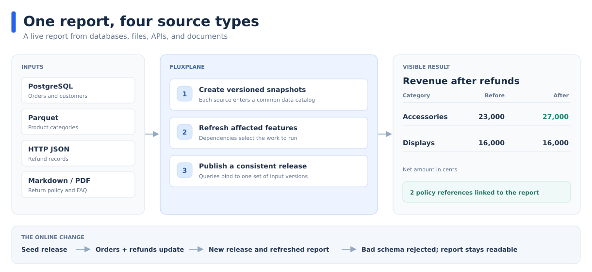

案例包含接入、计算、复用、更新、schema 检查和版本恢复。订单与退款更新后，受影响的特征刷新；未变化的文档特征保留原快照。不兼容的商品字段变更会被拒绝，已发布的数据仍可查询。

| 品类 | 初始净额（分） | 更新后净额（分） |
| :--- | ---: | ---: |
| Accessories | 23,000 | 27,000 |
| Displays | 16,000 | 16,000 |

上述数值来自[完整案例运行记录](docs/benchmarks/release-restore-20261109.json)。报表同时保留两份退货说明的关联计数。

### 一次更新，如何影响正在运行的查询

<p align="center">
  <a href="docs/assets/release-lifecycle.svg">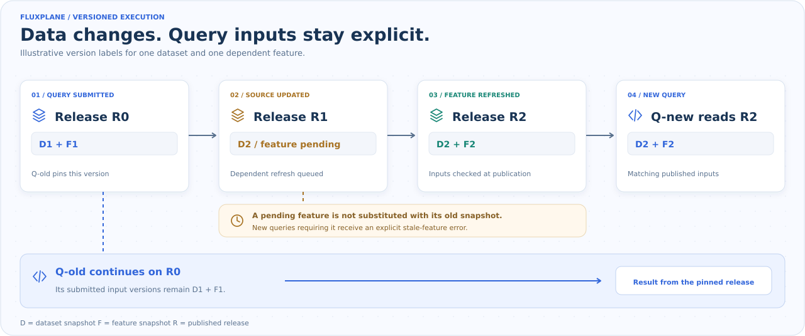</a>
</p>

图中的 `D`、`F`、`R` 分别表示数据快照、特征快照和发布版本，编号用于解释流程。**已提交查询保留原来的输入版本；新查询读取新的已发布组合。** 来源更新后，依赖旧输入的特征会从新发布组合中移除并安排刷新。若此时提交的查询需要该特征，系统明确返回过期状态，不会将新数据与旧特征拼在一起。刷新完成并通过输入版本校验后，特征重新发布。

<p align="center"><a href="docs/assets/release-lifecycle.svg">查看完整版本生命周期图</a></p>

<details>
<summary>继续演示：拒绝不兼容变更，恢复旧版本，再切回新版本</summary>

先暂停自动扫描，避免它与演示的故障注入同时操作来源：

```bash
docker compose stop scheduler
docker compose exec api python examples/full_demo.py --phase schema-guard
docker compose exec api python examples/full_demo.py --phase restore
docker compose start scheduler
docker compose exec api python examples/full_demo.py --phase verify
```

`schema-guard` 检查后恢复来源文件；`restore` 核对旧报表后切回更新后的版本。若中途退出，先运行 `docker compose start scheduler` 恢复调度。更多细节见[案例指南](docs/demo.md#检查发布与恢复)。

</details>

## 从 SQL 到应用接口

### 在控制台查询

完成 `seed` 后，在分析工作台运行以下 SQL。`demo_orders` 与 `demo_products` 分别来自 PostgreSQL 和 Parquet，查询读取平台中已发布的快照：

```sql
SELECT
    p.category,
    SUM(o.amount_cents) AS gross_cents
FROM demo_orders AS o
JOIN demo_products AS p ON o.product_id = p.product_id
GROUP BY p.category
ORDER BY p.category;
```

完整案例在此基础上连接退款和文档特征，生成净额报表。特征也可以用 SQL 定义，声明输入数据集、实体键和刷新方式后，由后台任务维护。

### 通过 REST API 提交

本地一键演示不需要访问密钥。默认 Compose 部署的 Web 入口同时代理 API：

```bash
export FLUXPLANE_URL='http://127.0.0.1:8088'

curl --fail-with-body "$FLUXPLANE_URL/api/v1/queries" \
  -H 'Content-Type: application/json' \
  -d '{"sql":"SELECT * FROM demo_products ORDER BY product_id"}'
```

接口返回 **HTTP 202** 和任务对象。用返回的 `id` 查询状态，任务 `succeeded` 后分页读取结果：

```bash
JOB_ID='replace-with-the-returned-id'

curl --fail-with-body "$FLUXPLANE_URL/api/v1/runs/$JOB_ID"

curl --fail-with-body "$FLUXPLANE_URL/api/v1/runs/$JOB_ID/rows?offset=0&limit=25"
```

来源、数据集、特征、执行计划和发布版本也通过 `/api/v1` 管理。若使用自己的 `.env` 设置了访问密钥，请在请求中添加 `X-API-Key`。接口与角色说明见[运行参考](docs/technical-reference.md)。

## 系统架构

**控制层决定何时执行和发布，执行层完成计算，版本目录记录查询所见的数据。**

| 层次 | 组成 | 职责 |
| :--- | :--- | :--- |
| 交互 | React 控制台、FastAPI、CLI | 提交查询与工作流，查看状态和结果 |
| 控制 | Scheduler、持久任务队列、依赖与租约 | 安排同步和刷新，进行资源准入，协调失败重试 |
| 执行 | 查询 worker、后台 worker、DuckDB、Arrow | 运行 SQL、特征计算、文档处理与存储整理 |
| 存储 | PostgreSQL 目录、不可变 Parquet 产物 | 保存元数据、快照、任务状态与发布版本 |

查询与后台更新使用独立执行池；后台持续空闲时可以帮助处理查询。每次查询固定提交时的发布组合，后续数据变化不会改变它的输入版本。新产物完成检查后，通过目录事务发布。

Compose 部署运行在单机上，本地开发也可使用 SQLite 目录。[架构与部署](docs/architecture.md) · [调度与运行观测](docs/technical-reference.md#调度与运行观测)

[动态架构图](architecture/fluxplane.html) · [高清模块图](architecture/fluxplane.png) · [20 秒流向视频](architecture/fluxplane.mp4) · [模块与代码对应](architecture/README.md)

## 当前范围

| 能力 | 已实现 |
| :--- | :--- |
| 数据接入 | PostgreSQL、SQLite、CSV、Parquet、JSON/JSONL、HTTP JSON、TXT/Markdown、含文本层的 PDF |
| 特征计算 | 实体级 SQL、跨源事件窗口、滚动求和/计数、追加聚合、内置文本算子 |
| 查询与工作流 | 自然语言分析计划、跨源只读 SQL、持久依赖、执行状态、查询结果分页与图表 |
| 调度 | 查询/后台分池、空闲借用、CPU/内存准入、取消与重试、租约恢复 |
| 版本与恢复 | 数据与特征快照、发布组合、历史恢复、产物校验、备份恢复 |
| 后台优化 | 重复查询物化、分区布局构建与验证、复用与运行画像 |
| 访问与观测 | 实例级管理员/操作员/只读密钥、实时事件、CPU/RSS 与任务耗时观测 |

FluxPlane 0.1 是可自行部署的**单机原型**。向量特征、多节点恢复、用户账户及数据集级多租户权限尚未提供。资源额度用于调度准入，不构成强制资源上限；增量特征刷新也不意味着所有来源都只读取增量。具体策略见[运行参考](docs/technical-reference.md)。

## 验证与性能

仓库同时提供可运行示例、自动化测试与测量记录，便于在自己的环境中检查行为。

| 想验证什么 | 入口 |
| :--- | :--- |
|  多源查询、更新与版本切换 | [完整案例](docs/demo.md)、[演示脚本](examples/full_demo.py) |
| Worker 退出后的任务恢复 | [恢复演示](docs/technical-reference.md#worker-故障恢复演示)、[脚本](examples/worker_recovery_demo.py) |
|  跨实例备份与产物完整性 | [部署与恢复](docs/operations.md)、`fluxplane verify-storage` |
|  百万行数据、增量刷新与混合负载 | [性能报告](docs/performance-report.md)、[原始测量](docs/benchmarks/) |
| 接口权限、发布一致性与窗口行为 | [测试目录](tests/)、[交付验收](docs/delivery-audit.md) |

性能报告分别记录本地执行和 Compose 部署条件，区分查询任务耗时、执行器耗时与后台刷新，并提供对应的复测命令。

## 运行与文档

本地运行建议使用 **Python 3.13、Node.js 24+ 和 npm**。安装与服务启动步骤见[本地运行](docs/technical-reference.md#本地运行)，容器部署与备份恢复见[运行维护指南](docs/operations.md)。

```bash
# 在已安装开发依赖的仓库根目录执行
.venv/bin/pytest -q
.venv/bin/ruff check .

cd apps/web
npm run build
npm run check:api
```

| 文档 | 内容 |
| :--- | :--- |
| [案例指南](docs/demo.md) | 接入、更新、拒绝不兼容变更和版本恢复 |
| [架构说明](docs/architecture.md) | 输入、控制、执行、存储与输出如何衔接 |
| [运行参考](docs/technical-reference.md) | 开发启动、接口、版本绑定、刷新与优化策略 |
| [部署与恢复](docs/operations.md) | 容器部署、备份、恢复与部署检查 |
| [扩展接口](docs/extensions.md) | 增加来源连接器、特征算子和后台任务 |
| [性能报告](docs/performance-report.md) | 测量条件、结果及复测命令 |

<details>
<summary>代码导航</summary>

```text
apps/web/                  React + TypeScript 控制台
packages/fluxplane/
  api/                     HTTP 接口与响应模型
  application/             数据、特征、查询与发布流程
  connectors/              多源快照读取
  execution/               SQL 查询执行
  features/                聚合、时间窗口与内置算子
  scheduling/              任务依赖、调度与租约
  storage/                 元数据与不可变产物
  migrations/              Alembic 数据库迁移
examples/                  完整案例、恢复演示与测量脚本
tests/                     行为与接口测试
deploy/                    容器与代理配置
docs/                      架构、运行、扩展与性能文档
```

</details>

## 许可证

FluxPlane 自有代码采用 [Apache-2.0](LICENSE)。控制台的部分主题与基础组件来自 [Shadcn Admin](https://github.com/satnaing/shadcn-admin)，其 [MIT 许可证及来源说明](third_party/shadcn-admin/README.md)独立保留。
