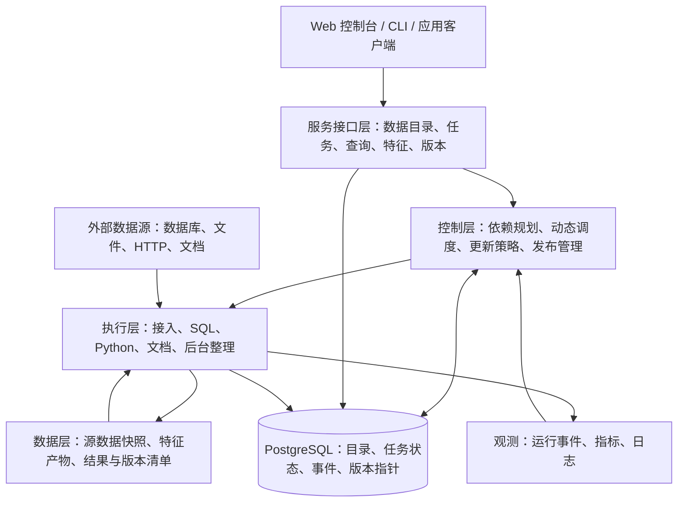

# FluxPlane：架构与实施计划

规划日期：2026-11-09。

已确认范围：同时覆盖数据特征（统计信息、业务衍生特征，可选向量）与运行特征（访问频率、任务耗时、资源占用）；首版交付可部署、可交互演示的通用原型。向量特征仍为可选扩展，不作为首版核心闭环的依赖。

本文保留目标架构和后续实施路径。当前已有独立工作区、真实多源查询与特征发布闭环、任务队列及 Web 控制台；文中其余接口、模块、性能目标和演示步骤仍是建设计划，不表示已经实现或测得。实际可用范围以 [README](../README.md) 为准。

当前进度：M0/M1 的目录、任务、执行与发布主路径可运行，元数据已有版本化迁移；M2 已有持久执行计划与依赖调度、双执行池并发限额、CPU/内存预留准入、等待老化、耗时反馈、取消和租约恢复；M3 已有文件和远程来源定期同步、发布组合、事务回退、声明式追加聚合的增量特征计算、注册的 Python 文本算子、PostgreSQL 与 HTTP 时间游标接入、可选的 SQL 特征定时刷新，以及单源滚动聚合与跨源 SQL 特征按事件进入和退出窗口的边界刷新；M4 已有 HTTP 同源分页快照、孤儿产物清理、受限的重复查询物化、构建成本与复用收益估计、物化淘汰，以及任务级进程 CPU/RSS 采样，分区文件整理已支持后台构建、等价性校验、过滤探针、按输入版本启用和自动候选；M5 已有首版控制台、实例级管理员/操作员/只读权限，六个页面的桌面与窄屏浏览器检查、SQL 交互及 SSE 任务刷新已通过。隔离的 Compose 实例已验证 PostgreSQL、Parquet、HTTP JSON、Markdown/PDF 四类来源的完整演示，包括初始化、数据更新、重复运行与重新初始化；重复查询物化、复用和来源更新后的失效也已通过真实 API 与 worker 验证；跨实例备份恢复已验证 21 个产物、1 个布局和恢复后的查询。

## 1. 产品定位与设计结论

交付一套能够接入多种数据、执行跨源分析、动态安排计算任务，并随数据和需求变化持续更新特征的原型系统。

核心能力形成一个闭环：

> 数据发生变化，系统识别受影响的特征和分析任务；调度器结合新鲜度、优先级和可用资源安排计算；完成的产物经过检查后发布；执行反馈用于下一轮调度和数据组织优化。

建议采用**模块化服务、独立执行进程、共享持久化状态**。各层按职责分离，首版部署在一台机器上，保留工作进程扩展接口。自然语言分析作为可选入口接入同一个任务系统。

首版重点是能运行、能恢复、能观察、能演示。既有的接入、计算、特征提取和后台优化能力按新接口抽取或重构；任务持久化、跨进程版本管理、统一 API 和控制台作为新的工程主干建设。

## 2. 范围与默认假设

### 2.1 首版交付范围

| 方向 | 首版必须可用的能力 | 后续扩展 |
|---|---|---|
| 文件数据 | CSV、Parquet、JSON/JSONL；批量导入、文件变更识别 | S3 兼容对象存储、更多文件格式 |
| 数据库 | PostgreSQL、SQLite；快照读取，满足条件时增量同步 | MySQL、日志级 CDC |
| HTTP 数据 | 显式配置分页、游标和字段映射的 JSON API | 更多鉴权与速率控制策略 |
| 文档 | TXT、Markdown、含文本层的 PDF；文本、分块与来源定位 | OCR、图像、音视频处理 |
| 查询与计算 | SQL、注册的 Python 算子、跨源关联、异步分析任务 | 更多执行引擎、通用分布式计算 |
| 特征更新 | 数据统计、实体级衍生特征、运行特征；依赖与版本管理 | 向量特征、模型在线特征服务 |
| 动态调度 | 依赖就绪、优先级、资源准入、新鲜度、重试、背压 | 多节点调度、更精细的资源隔离 |
| 自适应组织 | 重复计算物化、分区文件整理；限额内后台验证与启用 | 更多后端的索引和物理布局优化 |
| 使用方式 | 中文 Web 控制台、REST API、CLI | 多租户门户、复杂企业权限 |
| 部署 | 单机 Docker Compose；开发环境启动说明 | Kubernetes、高可用部署 |

PDF 的“接入”首版指文本提取、来源定位及派生特征，不承诺任意版面表格恢复。SQL 跨源查询对已导入的快照执行；源端查询下推按连接器能力单独实现。

### 2.2 “特征”的明确边界

| 对象 | 含义 | 用途 |
|---|---|---|
| 数据画像 `DataProfile` | 数据规模、字段类型、缺失率、基数估计和分布摘要 | 理解数据、判断变化、辅助规划 |
| 衍生特征 `FeatureDefinition / FeatureSnapshot` | 按指定实体或数据对象，通过有版本的计算定义生成的属性 | 查询、分析和后续计算 |
| 运行画像 `WorkloadProfile` | 一段时间内的访问频率、计算耗时、排队和资源消耗 | 调度、缓存和物化决策 |

三者共享依赖与版本机制，但使用不同的数据模型和更新策略。首版不把所有特征都解释为向量，也不把监控指标当作业务特征。

实体级特征必须声明主键和计算粒度。例如“客户近 30 天消费额”的粒度是客户，窗口是 30 天，定义明确事件时间与退款处理规则。仅仅给 SQL 起一个名字不构成完整的特征定义。

## 3. 分层架构



图中数据层表示持久化职责，不表示所有数据都要经过中央数据库。大型数据以文件和对象引用流转；PostgreSQL 只存元数据及较小状态。

### 3.1 各层职责与接口

| 层 | 职责 | 对外接口 | 不承担的职责 |
|---|---|---|---|
| 交互层 | 数据浏览、任务编排、运行观察、版本操作 | REST、SSE | 决定调度顺序或直接操作数据库内部状态 |
| 服务接口层 | 校验请求、权限、提交任务、查询结果 | `/api/v1/*`、统一错误模型 | 承载长时间计算 |
| 控制层 | 生成 DAG、安排运行、管理更新与发布 | Planner、Scheduler、VersionManager | 读取整表或执行重计算 |
| 执行层 | 按已确定的输入版本执行单个任务 | Connector、Operator、Executor | 自行修改活动版本或绕过配额 |
| 数据层 | 存储快照、产物、清单及依赖关系 | Catalog、ArtifactStore、StateStore | 用数据目录代替任务调度 |
| 观测支撑 | 统一事件、指标与追踪 | EventSink、Metrics | 作为发布状态的唯一来源 |

代码依赖方向：接口层调用应用服务，应用服务调用领域逻辑与抽象接口，具体数据库和连接器实现这些接口。领域模型不导入 FastAPI、数据库驱动或前端代码。

### 3.2 部署单元

- `api`：FastAPI 应用；接收请求，返回任务标识和状态。
- `scheduler`：初版单个活动实例；从持久化状态计算可运行任务并分配执行租约。
- `worker-query`：执行交互查询与短分析任务，拥有独立资源预算。
- `worker-background`：同步、特征刷新、物化和整理任务；首版至少一个，可启动多个。
- `web`：静态前端与反向代理。
- `postgres`：目录、依赖、任务、租约、事件与发布清单。
- 共享产物目录：首版本地文件系统，挂载给需要读写的服务；通过存储接口可替换为对象存储。

查询与后台 worker 使用独立进程和资源限额。DuckDB 按任务打开独立计算上下文，主要读取不可变 Parquet 快照；不让多个进程共同写一个嵌入式数据库文件。

## 4. 领域对象与状态

### 4.1 核心对象

| 对象 | 关键字段与责任 |
|---|---|
| `Source` | 类型、连接参数引用、权限范围、连接器能力；不保存明文密码 |
| `Dataset` | 逻辑名称、schema、主键、分区、来源 |
| `DatasetVersion` | 源游标、schema 版本、快照清单、创建时间、数据时间范围 |
| `FeatureDefinition` | 实体键、输入依赖、表达式/算子、代码版本、更新策略、时间语义 |
| `FeatureSnapshot` | 定义版本、输入版本向量、产物引用、质量状态、新鲜度 |
| `TaskSpec` | 算子、输入、依赖、优先级、资源请求、截止时间、幂等键 |
| `TaskAttempt` | 任务标识、尝试编号、worker、租约代次、心跳、退出状态 |
| `Run` | 一次用户请求或更新过程的 DAG、固定输入版本、任务与最终结果 |
| `Artifact` | URI、格式、schema、校验和、大小、所有者及引用关系 |
| `Release` | 一组可供查询的数据和特征版本；包含预期父版本 |
| `ExecutionObservation` | 输入版本、任务类型、排队/执行耗时、资源峰值、输出规模 |

大对象放入产物存储；小型配置使用 schema 化 JSON。频繁检索的标识、状态、时间与外键使用关系字段。数据依赖和特征依赖共用有向无环图，创建定义时检查环。

### 4.2 状态机

```text
任务：pending → ready → running → succeeded
                         ├→ retry_wait → ready
                         ├→ failed
                         └→ cancelling → cancelled

版本：building → validated → active → retired → collected
          └→ rejected

特征有效性：fresh / stale / blocked
```

任务完成与版本发布分别记录。计算成功但发布冲突时可以重用计算产物，经重新检查后再发布；不能把“文件写完”当成“所有查询已经切换”。

特征有效性独立于版本状态：已发布版本可以因上游更新变成过期，是否允许读取由查询的新鲜度要求决定。

## 5. 多源接入与统一数据访问

### 5.1 连接器合同

```python
class Connector(Protocol):
    def discover(self) -> list[DatasetDescriptor]: ...
    def capabilities(self) -> ConnectorCapabilities: ...
    def read_snapshot(self, request: SnapshotRequest) -> BatchStream: ...
    def read_changes(self, cursor: Cursor, limit: int) -> ChangeBatch: ...
```

接口是设计草案。能力包括是否支持主键、增量、删除事件、过滤下推、schema 发现和一致快照。缺少某项能力时，平台必须选择明确的替代路径，而不是假定所有来源都等价。

- 表格数据以 Arrow 批次进入执行层，落盘为 Parquet。
- 文档保存原始文件引用、提取文本、分块与来源位置，后续提取结果成为有 schema 的衍生数据集。
- schema 变化分类处理：兼容新增字段可发布新版本；字段删除和不兼容类型变化阻止受影响任务，等待定义更新。
- 文件导入使用稳定快照或写入完成标识，避免读取仍在修改的文件。
- 初始快照与后续增量必须有可衔接的游标；不支持该保证的来源只提供快照刷新。

### 5.2 增量同步的可兑现范围

首版 PostgreSQL 的游标增量要求稳定主键与可靠的更新标记，使用 `(updated_at, primary_key)` 分页，并结合重叠窗口去重。硬删除和无法由标记发现的迟到提交，采用软删除字段、周期性快照对账或后续 CDC 解决。连接配置明确所选模式。

HTTP 增量仅对具有稳定游标语义的 API 开放；普通列表接口执行快照导入。SQLite 首版默认快照读取，可对声明了可靠变更字段的表开放游标增量。

同步顺序为“读取批次 → 持久化产物 → 事务提交版本及新游标”。发生重试时重复读取允许发生，重复应用通过源键、源版本和唯一约束消除。

### 5.3 跨源一致性

每次分析固定一个输入版本向量，例如数据库版本、文件快照与文档版本。特征及缓存必须匹配这个向量。

这是平台内的可重复读取，不等于多个外部系统在同一瞬间的分布式事务快照。需要时间对齐的任务声明可接受的时间偏差，由 planner 检查。

## 6. 动态调度

### 6.1 调度解决的实际问题

新数据到达不应触发全部重算；后台整理不应占满交互查询的资源；重复更新请求不应产生重复构建；失败任务应能恢复；低优先级任务也需要获得运行机会。

调度循环按以下顺序处理：

1. 读取变化事件，合并同一目标的待处理刷新请求。
2. 检查依赖、输入版本、新鲜度和连接器能力。
3. 形成就绪队列，区分交互、同步、特征刷新和后台整理。
4. 在各队列保证份额的基础上，考虑截止时间、等待时间与预计资源成本。
5. 选择资源可容纳的 worker，持久化租约后派发。
6. 接收执行结果，释放资源，唤醒下游并更新运行画像。

首版策略采用确定规则和可解释评分。基于观测更新耗时估计，不以模型调用作为每次调度的前提。

### 6.2 资源与公平性

- 资源向量：CPU 配额、内存上限、临时磁盘和可选 GPU/外部 API 并发。
- 查询 worker 始终处理交互任务；后台 worker 优先处理后台任务，持续空闲一段时间后才借给查询。默认观察期为 500 ms，可按负载调整。新后台任务到来后不再派发新的借用查询，已运行的查询会完成。
- 长任务切成可检查点的批次，允许批次边界让出资源。首版不承诺任意 SQL 的无损暂停。
- 对无法容纳的大任务返回 `resource_unschedulable`，避免无限排队。
- 队列老化与最低份额共同降低饥饿风险；只有在任务可容纳且持续有相应资源时保证进展。
- 资源和预计收益稳定一段时间后才调整后台策略，避免每次小波动都重排或重建。

### 6.3 持久化、重试和取消

PostgreSQL 的 `FOR UPDATE SKIP LOCKED` 用于短事务领取队列记录，不用于模拟业务数据的一致快照。

任务租约包含单调递增代次。worker 回报结果和发布版本时都检查代次，过期 worker 无权提交。超时后的重试产生新的 `TaskAttempt`，保留原尝试记录。

任务执行语义为至少一次；产物可见性通过幂等键、唯一约束和版本发布事务去重。任务按类型区分可自动重试、需核对外部效果和不可自动重试；首版不允许任意对源库的业务写操作。

数据版本提交与变化事件在同一数据库事务中写入。消费者维护处理位点，通过唯一键去重；通知仅用于唤醒，调度器始终可以通过持久事件表补读。这样服务重启或通知丢失不会遗漏特征刷新。

worker 分配与资源预留共同提交。失联后的资源释放由调度器核对租约与进程状态，避免旧任务仍在运行时把同一资源重复分配。单机原型可以结合容器状态确认进程退出；无法确认时暂停对应资源的再分配。

取消先标记请求，支持中断的执行器终止计算；不支持的在批次结束停止。取消与发布在事务中确定顺序：取消已生效的任务不能随后发布。

## 7. 特征更新与持续适应

### 7.1 定义方式

下面仅展示计划中的配置形态：

```yaml
name: customer_spend_30d
entity_keys: [customer_id]
inputs:
  - dataset: orders
  - dataset: refunds
operator: rolling_net_spend
operator_version: "1"
event_time: occurred_at
window: 30d
refresh:
  on_source_change: true
  max_staleness: 60s
  coalesce_window: 5s
late_data:
  allowed_lateness: 10m
  action: recompute_affected_partitions
```

`60s` 和 `10m` 是演示配置，不是平台固定保证。更新策略和任务配额决定能否满足新鲜度，系统报告实际完成时间和超期状态。

### 7.2 更新规则

| 触发 | 处理 |
|---|---|
| 新增或更新数据 | 沿依赖图定位受影响的实体、分区和特征 |
| 删除数据 | 按删除标记撤销相应贡献；不支持撤销的算子重算受影响分区 |
| 滚动窗口到期 | 即使没有新数据，也调度窗口过期更新 |
| 特征定义或模型变化 | 创建新定义版本并刷新依赖产物 |
| schema 不兼容变化 | 阻止发布，显示具体受影响字段和定义 |
| 访问热点变化 | 调整刷新优先级、物化保留及后台整理顺序 |

只有声明增量维护规则的算子可以走增量路径。求和和计数可维护中间状态；去重计数、任意 Python 和复杂关联默认重算受影响分区。近似统计必须声明误差属性，不把近似画像用于精确业务结果。

### 7.3 一次完整更新

```text
数据变更 → 提交数据版本 → 标记受影响特征过期
         → 合并刷新需求 → 固定输入版本 → 计算变更部分
         → 校验 schema / 主键 / 时间范围 / 规则
         → 事务发布特征版本与完成事件 → 后续查询使用新版本
```

执行期间出现更晚的数据版本时，不丢失新的刷新需求。当前结果可作为有明确水位的版本发布；若请求要求更高新鲜度，继续调度后续刷新。

### 7.4 前台读取策略

- `consistent`：固定完整的数据与特征版本组合，允许读取明确标注时间的旧组合。
- `fresh`：要求满足新鲜度阈值；未满足时触发刷新并等待到请求期限，或返回可解释的未就绪状态。

默认不将新数据和旧特征静默拼接。查询返回输入版本及更新时间，详细信息放在结果详情中，不挤占主要使用流程。

### 7.5 运行反馈与组织优化

执行完成后产生结构化观测，按数据对象、算子和查询模式聚合为滚动运行画像。系统据此发现高频重复计算或文件碎片，提出物化和整理任务。

后台组织优化与必需的数据刷新分开决策：刷新保证数据可用性和新鲜度；组织优化需要预计收益足以覆盖构建和存储成本，并经过实际校验后才启用。

首版实现两个完整动作：

1. **注册计算物化**：对表达式与输入版本完全匹配的计算复用结果；依赖变化后失效或刷新。
2. **分区文件整理**：合并小文件，按声明的常用过滤键整理分区；比较结果等价性、读取成本和空间占用。

任意 SQL 的语义等价重写不在首版承诺内。索引创建和其他后端操作通过能力接口扩展，不把不同引擎的支持情况视为相同。

## 8. 版本发布、恢复与存储生命周期

### 8.1 发布流程

1. worker 在独立的产物路径构建结果。
2. 完成格式、内容和依赖校验，生成不可变 manifest。
3. 文件持久化后，在 PostgreSQL 事务中检查任务租约、预期父版本和输入依赖。
4. 同一事务更新活动版本指针、产物引用和完成事件。
5. 查询在开始时绑定并登记所用 release，结束后释放读取租约。

发布只处理元数据，不在事务内重算、复制大文件或等待模型调用。文件存储与数据库不参与分布式事务：先完成文件写入，数据库决定其可见性；未被引用的文件由恢复扫描清理。

本地持久化需要明确文件与目录落盘顺序；进程退出恢复首先纳入测试，断电耐久性另行验证，不能由“原子重命名”直接推导。

### 8.2 回退与回收

回退到兼容且仍保留的 release，作为一次新的发布动作记录。定义变化或上游数据变化后，不能仅替换特征指针；必须使用匹配的数据版本组合。

旧 release 在保留窗口内且没有读者引用时才能回收。跨进程读者租约通过数据库维护，心跳与保守宽限期避免误删长查询使用的文件。仍被其他 release 引用的共享分区不删除。

租约到期并不单独构成删除依据。执行器失去续租能力后停止发起新读取；回收器还需确认相应单机 worker 已退出或完成读操作，无法确认时保留文件。

物理删除失败保留待回收标记并重试，不撤销已经成功的发布。

## 9. 服务接口与用户界面

### 9.1 API 草案

| API | 用途 |
|---|---|
| `POST /api/v1/sources` | 注册数据源，引用凭据 |
| `POST /api/v1/sources/{id}/discover` | 发现可接入对象 |
| `POST /api/v1/datasets/{id}/sync` | 提交同步任务 |
| `GET /api/v1/datasets/{id}/versions` | 查看数据版本 |
| `POST /api/v1/features` | 创建特征定义 |
| `POST /api/v1/features/{id}/refresh` | 提交刷新需求 |
| `GET /api/v1/features/{id}/snapshots` | 查看特征版本与状态 |
| `POST /api/v1/queries` | 提交带新鲜度要求的查询 |
| `GET /api/v1/runs/{id}` | 查询 DAG、任务及结果 |
| `POST /api/v1/runs/{id}/cancel` | 取消运行 |
| `GET /api/v1/events` | SSE 推送进度，支持事件序号续传 |
| `POST /api/v1/releases/{id}/restore` | 恢复兼容版本 |
| `GET /api/v1/system/metrics` | 系统与调度状态 |

长操作统一返回 `202 + run_id`。提交支持 `Idempotency-Key`；重复提交返回同一逻辑运行。结果分页或提供产物下载，避免把大表作为 API JSON 一次返回。

### 9.2 控制台页面

精美、统一且可交互的控制台为正式交付要求。首版已抽取 Shadcn Admin 的布局与组件，并用 React Flow 和 Recharts 实现依赖图及运行视图；模板比较、视觉规范、交互合同及阶段安排见[前端选型与产品设计](frontend-plan.md)。

1. **总览**：接入状态、队列、数据新鲜度、最近更新和资源占用。
2. **数据目录**：数据源、schema、预览、版本与同步状态。
3. **特征管理**：定义、依赖、更新时间、版本比较、刷新。
4. **任务中心**：DAG、状态、等待原因、重试和取消。
5. **分析工作台**：SQL 与已注册分析操作，结果和来源；可选自然语言入口。
6. **运行与存储**：调度决策、后台优化、版本占用与回收。

页面使用真实运行状态驱动。演示中的数据变化与故障通过明确的演示按钮触发，不用预写曲线代替实际运行。

### 9.3 基础访问控制与运行维护

- 初始角色为管理员、操作员和只读用户，分别限制源配置、任务/版本变更和结果读取；API 和控制台使用同一权限检查。
- 凭据通过部署 secret 或环境注入，只保存引用；数据库源默认使用只读账号。普通查询不能执行 DDL/DML 或任意外部文件访问。
- 文件接入和 HTTP 接入限定允许的目录和目标地址；日志不记录凭据或整段敏感源数据。
- 健康检查区分进程存活与服务就绪；优雅退出停止领取新任务并收尾现有租约。
- 备份包括数据库元数据和仍被引用的不可变产物，提供维护窗口下的一致备份与恢复流程；恢复后验证引用与校验和。
- 配置修改保留版本，依赖版本与容器镜像在首轮兼容测试后锁定。当前已有数据库和服务不复用其数据目录。

## 10. 技术选型

| 部件 | 首选 | 选择原因 |
|---|---|---|
| 后端语言 | Python 3.13 | 复用数据处理生态，固定独立环境，避免依赖宿主默认版本 |
| API 与配置 | FastAPI、Pydantic | 类型化接口和配置校验，自动 OpenAPI |
| 元数据与队列 | PostgreSQL 16 或兼容受支持版本 | 事务、条件更新、唯一约束、持久化任务队列 |
| ORM / 迁移 | SQLAlchemy 2、Alembic | 模式迁移和清晰事务边界 |
| 分析执行 | DuckDB 1.x，经兼容测试固定精确版本 | SQL、Parquet、Arrow 的单机分析能力 |
| 数据交换 / 落盘 | Arrow / Parquet | 批次交换、列式读取、不可变分区 |
| 前端 | React、TypeScript、Vite；Shadcn Admin 布局与组件 | 与独立后端匹配，统一主题、导航、表格及交互 |
| 依赖图与指标 | React Flow、Recharts | 任务/特征依赖可视化与实时运行趋势 |
| 状态更新 | SSE + REST | 单向进度推送，断线可续传 |
| 观测 | 结构化日志、OpenTelemetry 接口、Prometheus 指标 | 统一请求、任务与后台计算的关联 |
| 测试 | pytest、集成测试、Playwright | 核心状态、真实服务与用户流程验证 |
| 部署 | Docker Compose | 单机完整交付和资源限额 |

首版不强制引入 Kafka、Flink、Ray、Kubernetes 或全量特征平台。未来需要日志级 CDC 时接 Debezium；需要大规模历史/在线特征服务时评估 Feast；需要复杂长生命周期工作流时评估 Temporal。具体依据见技术调研文档。

## 11. 可选智能分析扩展

自然语言分析可以保留为产品能力，但不与核心调度绑定：

```text
用户问题 → 分析规划器 → 查询目录和特征 → 生成受约束任务 DAG
        → 统一执行 → 检查结果 → 返回答案和来源
```

- 规划器只能调用已注册的操作，遵守相同的输入版本、配额和权限。
- 首版的无模型演示必须完整可用；外部 API 或本地模型通过独立 provider 接口接入。
- 默认 Python 执行限于受信任注册算子。若开启生成代码，使用受限容器、只读输入、禁止默认联网、资源限额和超时；普通子进程隔离不视为安全沙箱。
- 可复用分析模板只在对应数据范围和输入要求成立时使用，数据变化后重新检查适用性。

## 12. 能力抽取与独立工程规范

本轮代码阅读确认存在多源解析、工作负载特征、操作能力约束、资源准入、候选验证与版本切换的基础实现，也发现较大的编排文件和特定运行方式的依赖。本轮未运行这些模块的测试，不把可读代码直接认定为可交付组件。

| 能力 | 处理方式 |
|---|---|
| 文件解析、schema 与基础画像 | 按 Connector 和 DataProfile 接口抽取，补异常输入及 schema 变化测试 |
| SQL/代码执行 | 使用新任务合同重新封装，移除评测与路径依赖 |
| 查询/运行特征统计 | 保留可解释的提取逻辑，改为有界滚动聚合 |
| 资源准入与后台候选检查 | 抽取独立策略函数，与持久化调度分离 |
| 版本发布与生命周期 | 保留隔离构建、验证、切换、回收的设计；重建跨进程事务和租约 |
| 大型实验 runner | 不进入产品依赖树 |
| 结果表、绘图、评测脚本和历史数据 | 不进入产品仓库与演示数据 |

独立交付要求：

- 新工作区、新包命名、新配置前缀 `FLUXPLANE_`、新数据库 schema 和新产物格式。
- 源码、提示词、注释、页面、日志、异常、文件元数据与容器标签均使用新产品术语。
- 不导入或软链接已有研究目录，不复制旧 Git 历史、测试结果、缓存、密钥或绝对路径。
- 演示使用新建的业务数据及独立种子，数据生成规则随包交付。
- 仅迁移已确认可使用的代码；第三方许可证与必要版权声明保留，归入依赖说明。
- 交付前对源码、构建产物和运行输出执行旧品牌、旧路径和旧内部标识扫描，要求无产品内容残留。
- 独立环境启动测试不能依赖原工作区存在。

## 13. 仓库布局

下列为目标分层；当前仓库已包含独立后端、前端、迁移、容器配置和演示脚本，部分模块仍按后续阶段逐步细化。

```text
fluxplane/
├── apps/
│   ├── api/
│   ├── scheduler/
│   ├── worker/
│   └── web/
├── packages/fluxplane/
│   ├── domain/            # 数据、特征、任务、版本
│   ├── application/       # 用例与事务边界
│   ├── ports/             # 连接器、存储、执行器合同
│   ├── connectors/
│   ├── execution/
│   ├── scheduling/
│   ├── features/
│   ├── optimization/
│   ├── storage/
│   └── observability/
├── migrations/
├── deploy/
├── examples/
├── tests/
│   ├── unit/
│   ├── integration/
│   ├── recovery/
│   └── e2e/
├── docs/
├── pyproject.toml
└── README.md
```

包依赖检查与 API 合同测试防止分层退化为目录命名。版本切换只能通过 VersionManager 完成，执行器不能直接写活动版本指针。

## 14. 实施顺序与阶段产物

以下为工程量估计，不是已安排的工期。按单名熟悉 Python/数据系统的工程师计算，约 23–34 个有效工作日，集成环境差异可能增加工作量。先交付端到端闭环，再增加连接器和交互复杂度。

| 阶段 | 内容 | 可运行产物 | 预计工程量 |
|---|---|---|---|
| M0：基础服务与接口 | 独立项目、模型、迁移、任务状态、产物接口、API 骨架 | 启动服务、提交任务、查询状态 | 2–3 日 |
| M1：最小闭环 | CSV/Parquet + PostgreSQL、同步、SQL、静态特征、发布与查询 | 两源关联查询，特征第一次发布 | 4–5 日 |
| M2：可靠动态调度 | DAG、队列份额、资源准入、租约、重试、取消、恢复 | 并发前后台任务，worker 退出后恢复 | 4–6 日 |
| M3：增量与版本 | 依赖失效、增量算子、迟到数据、窗口到期、版本回退 | 数据变化后只刷新受影响内容 | 5–7 日 |
| M4：完整接入与优化 | SQLite、HTTP、文档、运行画像、物化、文件整理 | 多源业务场景与后台优化闭环 | 4–6 日 |
| M5：控制台与交付 | 前端联调、演示、端到端测试、打包和文档 | 全套可交互原型与独立部署包 | 4–7 日 |

前端骨架在 M1 使用真实 API 建立，随后随各阶段补齐功能；M5 集中完成体验和打包。可选模型接口在 M4 后接入，不阻塞基本交付。

实施依赖：M0 → M1 → M2 → M3；M4 的连接器可在 M2 稳定后扩展，组织优化依赖 M3 的发布机制；最终验收在 M5 汇总。

第一轮实现只做一条真实路径：注册两个数据源、同步快照、执行关联、计算一个特征、发布并查询。这个闭环确定模型与接口是否足够，再扩展功能。

## 15. 演示与验收

### 15.1 主演示：多源经营分析

数据来源：PostgreSQL 订单、Parquet 商品、HTTP JSON 退款、Markdown/PDF 服务说明。统一目录展示各自结构和更新时间。

特征：客户滚动净消费额、商品退货率、文档分块与确定性的主题标签。跨源分析回答指定时间窗口内不同品类的收入与退货情况，并关联相关说明。

演示步骤：

1. 导入来源，展示数据目录和特征依赖。
2. 提交查询与后台刷新，展示两类任务同时推进。
3. 注入订单和退款变更，只刷新受影响实体/分区。
4. 注入迟到记录和一次不兼容 schema 变化，展示修正与阻止错误发布。
5. 改变查询热点，展示后台物化的创建、使用和失效。
6. 停止一个 worker，展示任务恢复和不重复发布。
7. 查看两个 release，在兼容条件下恢复旧版本并显示数据时间。

事件注入使用可重复脚本；每个结果由真实执行产生。演示数据从小规模开始，可扩大到百万行级，保持相同业务语义。

### 15.2 功能与正确性验收

| 检查项 | 通过标准 |
|---|---|
| 多源分析 | 至少数据库、列式文件、HTTP、文档四类输入有实际运行链路 |
| SQL 与特征正确性 | 与独立全量重算参考结果一致；浮点比较声明容差 |
| 更新完整性 | 新增、修改、删除、迟到数据及窗口过期均有预期结果 |
| 重复请求 | 同一幂等键不会产生重复可见产物 |
| 崩溃恢复 | 构建、文件写完未提交、提交后未回报三个故障点均恢复一致状态 |
| 并发发布 | 过期租约和过期父版本不能覆盖当前版本 |
| 读取一致性 | 长查询期间发布新版本，原查询仍读取其绑定版本 |
| 存储回收 | 活跃读者和共享引用使用的文件不被回收 |
| 调度 | 优先级、依赖、配额、等待时间真实影响执行顺序 |
| 独立交付 | 新环境可启动，旧目录不可访问时演示仍完成 |
| 前端 | 数据接入、刷新、查询、取消、版本查看全过程无手工改数据库 |

### 15.3 性能评估与初始目标

M1 固定演示资源配置与数据集，记录真实基线；M2 后评估调度；M3 后评估增量更新。以下指标是目标，不承诺预定速度提升。

- 小型控制请求在本地部署下 p95 目标小于 300 ms，明确不含长计算。
- 正常负载下已就绪短任务的调度延迟 p95 目标小于 1 s。
- 用 1%、10%、50% 数据变更比例比较增量刷新与全量重算；不适合增量的算子展示回退行为。
- 前台与后台混合负载比较固定并发和动态调度：前台 p95、后台新鲜度达标率、总吞吐、资源峰值同时报告。
- 测量小数据与百万行级数据的端到端时间、扫描量、增量写入量和存储占用。
- 对物化和整理分别记录构建成本、使用次数、命中后节省时间与回收空间；不只展示命中查询的速度。

最终交付实际指标与适用范围。功能验收不依赖凑出某个加速比。

## 16. 交付清单

1. 独立源码仓库与依赖锁定文件。
2. 单机容器编排、环境模板、数据库迁移和健康检查。
3. Web 控制台、REST API 文档与 CLI。
4. 核心连接器、执行器、特征算子和调度策略。
5. 演示数据生成器、场景脚本及操作说明。
6. 功能、恢复、并发与端到端测试。
7. 实际测量的性能报告和限制说明。
8. 架构图、接口扩展指南、部署/恢复/升级说明。
9. 产品命名与路径清理检查、第三方依赖许可证说明。

## 17. 需要尽早核定的条件

这些条件不会阻塞当前规划；实现时按默认值推进，发现不符再调整对应模块。

| 条件 | 当前默认 |
|---|---|
| 特征的主要用途 | 已确认：同时覆盖数据画像、实体级衍生特征和运行画像；向量可选 |
| 核心用户 | 需要接入与分析数据的研发/数据人员 |
| 运行环境 | 单机 Linux，容器部署，使用独立端口和数据卷 |
| 真实数据接入 | 首版使用独立演示数据，不连接现有业务写库 |
| 模型依赖 | 可选；无模型也能完成全套核心演示 |
| 实时要求 | 秒到分钟级更新，按任务新鲜度配置；不承诺毫秒级流处理 |
| 分布式要求 | 首版多进程，后续多节点；不宣称高可用集群 |
| 产品名称 | 暂定 FluxPlane，可统一替换 |

实现与验证进度持续记录在 README；本文件中的未完成能力仍为目标设计。
