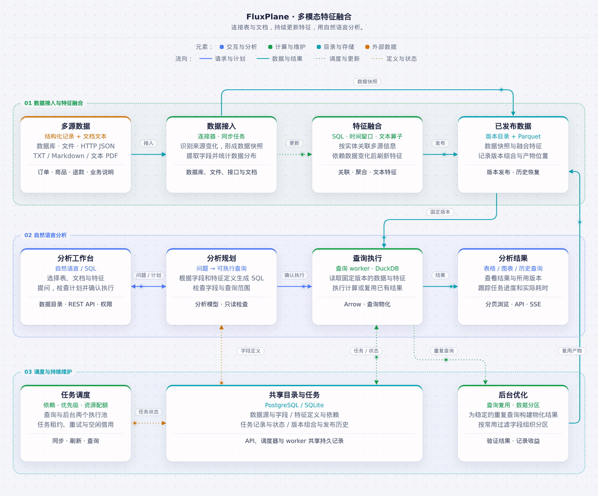

# 系统架构

FluxPlane 将结构化记录与文档文本接入统一目录，持续维护融合特征，并让用户用自然语言或 SQL 分析已发布的数据。数据更新与查询独立运行，通过任务、版本和产物存储协作。

[动态架构图](../architecture/fluxplane.html) · [20 秒流向视频](../architecture/fluxplane.mp4) · [模块与代码对应](../architecture/README.md)

## 从输入到输出

1. **接收请求与数据。** 用户通过 Web、REST API 或 CLI 提交查询、同步和刷新；来源适配器读取数据库、文件、HTTP JSON 和文档。
2. **形成分析计划。** 自然语言入口将问题与所选表的字段、特征定义交给配置的模型，生成 SQL，并检查字段和只读操作。用户确认后提交查询。SQL 入口直接使用相同的任务执行流程。
3. **执行计算。** 查询与后台更新使用独立 worker 池。SQL、文档处理、特征计算和数据整理读取已确定的输入版本。
4. **发布结果。** 数据快照和特征产物写入不可变文件；目录在事务中切换活动发布组合。查询绑定一个发布组合，因此不会在同一次请求中混读新旧版本。
5. **维护与复用。** 调度器根据来源变化、依赖和刷新周期安排后台任务。稳定的重复查询可触发结果物化，合适的过滤字段可组织为分区布局，验证后用于后续查询。

## 部署单元

单机 Compose 部署包含 Web、API、scheduler、查询 worker、后台 worker 和 PostgreSQL。PostgreSQL 保存目录、任务、租约与发布指针；数据、特征和查询结果保存在不可变 Parquet 产物中。连接器与算子通过[扩展接口](extensions.md)增加。

部署与备份方法见[部署文档](operations.md)。
