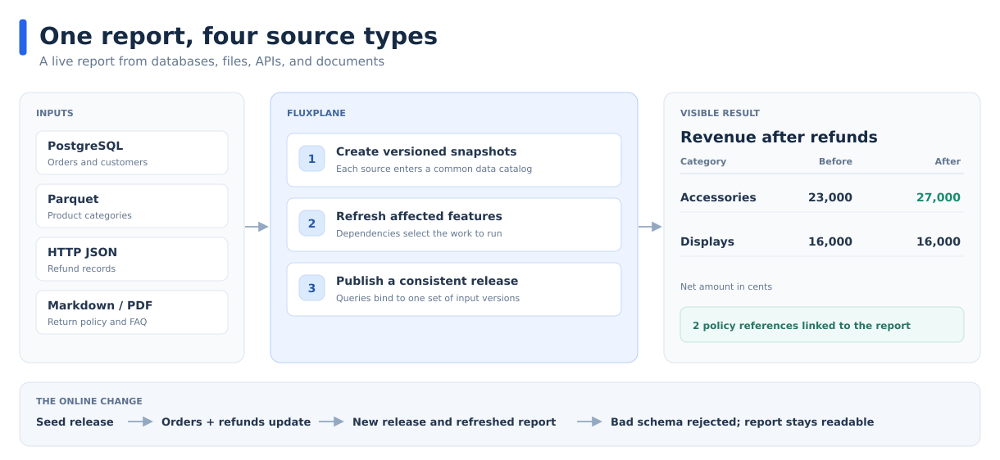

# 案例演示：四类来源汇成一份持续更新的报表

这套演示随仓库提供，数据由 [`examples/full_demo.py`](../examples/full_demo.py) 创建并核验。它回答一个具体问题：**当订单与退款分别来自不同系统时，报表能否使用一致的数据版本持续更新？**



## 运行

先按[快速体验](../README.md#快速体验)一键启动，脚本已完成 `seed`。以下命令均在仓库根目录执行：

```bash
docker compose exec api python examples/full_demo.py --phase optimize
docker compose exec api python examples/full_demo.py --phase update
```

| 阶段 | 在控制台查看 | 预期结果 |
| --- | --- | --- |
| `seed` | 数据目录、特征依赖、分析工作台 | PostgreSQL 订单、Parquet 商品、HTTP 退款与 Markdown/PDF 说明成为已发布数据；报表可以跨源查询 |
| `optimize` | 任务中心、版本与存储 | 稳定的重复查询形成物化结果，随后出现复用记录 |
| `update` | 特征中心、发布历史、分析工作台 | 订单与退款变化后，相关特征和报表更新；未变化的文档特征保留原快照 |

控制台截图：[特征依赖](assets/console-features.png) · [发布版本](assets/console-versions.png) · [系统总览](assets/console-overview.png)。

演示脚本逐项核对查询和特征结果。报表中的净额以**分**为单位：

| 品类 | 初始报表 | 更新后 |
| --- | ---: | ---: |
| Accessories | 23,000 | 27,000 |
| Displays | 16,000 | 16,000 |

两份退货说明被计入报表。上述数值可与[一次完整运行的版本切换记录](benchmarks/release-restore-20261109.json)对照。

## 检查发布与恢复

演示还包含两个可单独观察的行为。先暂停自动扫描，临时移除商品数据的必需字段；平台应拒绝该版本，保留正在服务的报表。随后恢复旧发布组合、核对旧报表，再切回更新后的组合。

```bash
docker compose stop scheduler
docker compose exec api python examples/full_demo.py --phase schema-guard
docker compose exec api python examples/full_demo.py --phase restore
docker compose start scheduler
docker compose exec api python examples/full_demo.py --phase verify
```

`schema-guard` 会在检查后恢复来源文件。`restore` 会在返回前切回更新后的发布组合。若中途退出，可先运行 `docker compose start scheduler` 恢复自动调度。重新运行 `seed` 会重置**演示来源**，请在独立实例中使用。

更多关于任务状态、版本绑定与更新策略的说明见[架构说明](architecture.md)和[运行参考](technical-reference.md)。
