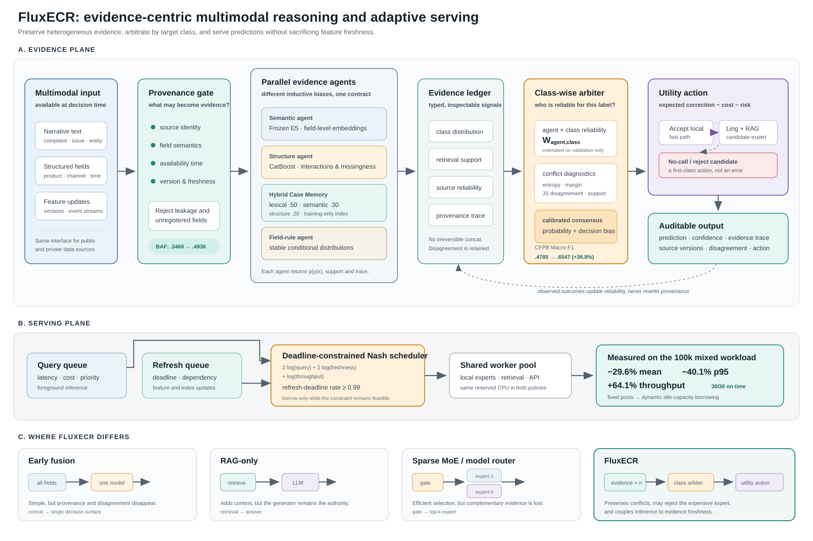

# FluxECR experiments

FluxECR studies a single question: **how should a model-serving system combine text, structured fields, historical cases and changing features when no single source is always reliable?**

The method does not concatenate every signal and hope that one model learns the right answer. It first turns each source into an explicit piece of evidence, estimates where that evidence is trustworthy, resolves conflicts by target class, and then decides whether the local result is sufficient or an external model is worth consulting. The same decision principle is used below the model layer to balance foreground queries against feature refreshes.



## Method in one pass

1. **Provenance gate.** Every field is checked for origin, semantics, freshness and whether it would exist at prediction time. Anonymous or post-outcome fields cannot silently dominate a decision.
2. **Evidence agents.** A frozen E5 encoder reads narrative fields; CatBoost models structured interactions; Hybrid Case Memory retrieves lexically, semantically and structurally similar training cases; field rules expose stable conditional distributions.
3. **Class-wise arbitration.** Each agent has a separate reliability for each target class. The arbiter combines probability, retrieval support, entropy and disagreement instead of using one global fusion weight.
4. **Utility action.** The system may accept the local consensus, ask Ling with retrieved evidence, or keep the local answer. An external model is a candidate expert, not an automatic replacement.
5. **Adaptive serving.** A deadline-constrained Nash objective allocates workers between queries and feature refreshes, so lower latency does not come from allowing evidence to become stale.

The encoder is frozen throughout the main experiment. CatBoost and small calibration parameters are fitted on the training and validation partitions, but there is no E5, LoRA or Ling fine-tuning. This isolates the value of the framework itself.

## Evaluation at a glance

| Question | Benchmark | Main comparison | Result |
| --- | --- | --- | --- |
| Does heterogeneous evidence improve an imbalanced prediction task? | CFPB Consumer Complaint Database, chronological 20,610 / 6,870 / 6,871 split | Basic TF-IDF → FluxECR | Macro-F1 0.4785 → 0.6547 (+36.8%); Macro-AP 0.5374 → 0.6465 |
| Does provenance help under temporal feature failure? | Bank Account Fraud, Base and Variant V, official month split | CatBoost → provenance-gated LightGBM | TPR@5%FPR 0.3469 → 0.4936 on Variant V (+42.3%) |
| Can queries borrow idle capacity without starving feature refreshes? | 100k-row mixed query/update workload in isolated Compose | fixed pools → dynamic borrowing | mean latency −29.6%, p95 −40.1%, throughput +64.1%; 36/36 refreshes within 2 s |

The first percentage is relative to a deliberately simple baseline. Against the stronger joint Frozen-E5 + CatBoost baseline, FluxECR improves Macro-F1 by 11.8% and Macro-AP by 0.47%. Both comparisons are reported because they answer different questions.

## Experiments

- [Consumer response prediction](consumer-complaints/README.md) defines the multimodal task, metrics, baselines, ablations and full result table.
- [Fraud under temporal drift](fraud-drift/README.md) evaluates feature provenance when an apparently predictive field stops being dependable.
- [Query/update scheduling](scheduling/README.md) measures latency, freshness and throughput under the same workload.
- [Comparison with adjacent paradigms](comparison.md) contrasts FluxECR with early fusion, retrieval-augmented prediction, sparse MoE and LLM routing.

Machine-readable headline results are in [results/summary.json](results/summary.json). The linked raw JSON files preserve the complete configurations and measurements.

## Reproduction

Install the optional experiment dependencies:

```bash
python -m pip install -e '.[experiments,embedding-experiments]'
```

Run the frozen-encoder experiment:

```bash
python examples/benchmark_frozen_e5.py \
  --input /path/to/CCDB_Export.zip \
  --output docs/benchmarks/cfpb-response-hybrid-case-agentic-local-new.json
```

Run the fraud and scheduler experiments:

```bash
python examples/benchmark_baf.py \
  --input /path/to/Base.csv /path/to/'Variant V.csv' \
  --output docs/benchmarks/baf-base-variant-v-local-new.json

python examples/tune_scheduler.py \
  --rows 10000 --queries 8 --features 3 --late-features 3 \
  --rounds 10 --grace-ms 0 100 250 500 1000 \
  --output docs/benchmarks/scheduler-tuning-local-new.json
```

All reported quality numbers use the complete fixed test partition. Hyperparameters and decision biases are selected on the validation partition only.
